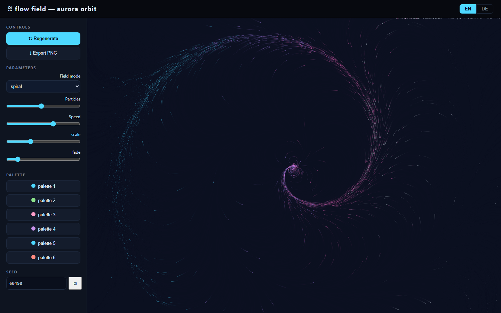
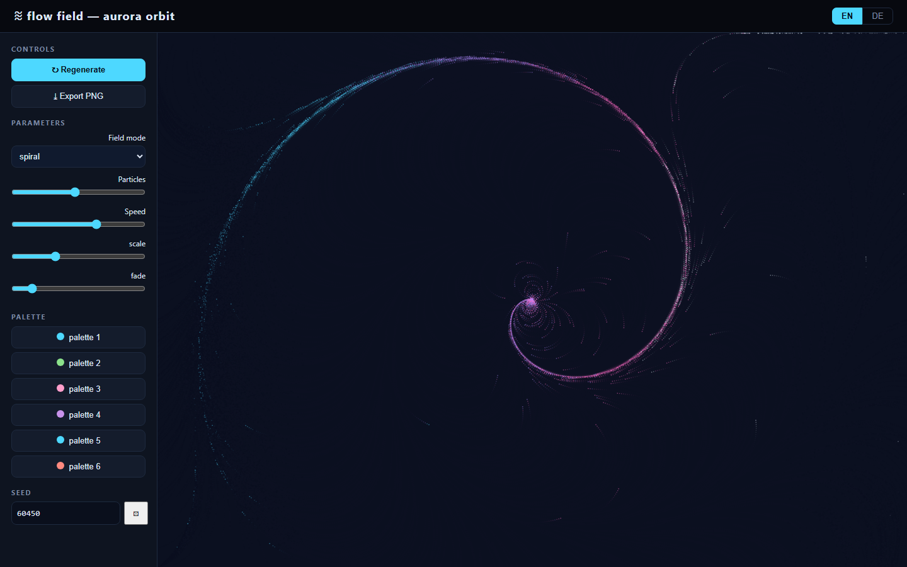
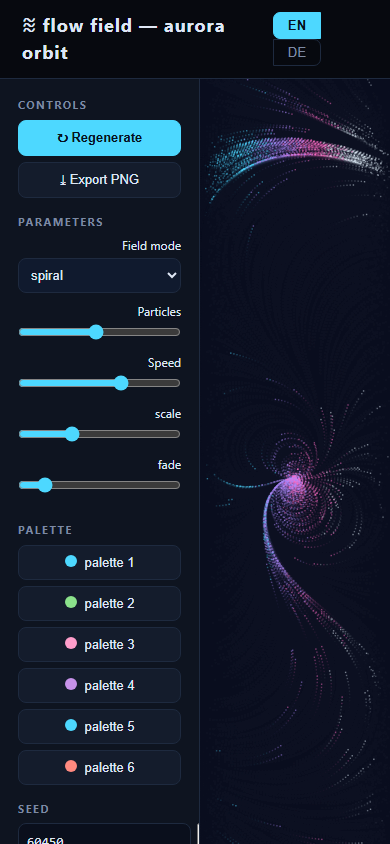

# Flow Field — Aurora Orbit

A living flow-field painter: 2009 particles trace vector fields in real time. spiral mode, seeded randomness and PNG export.

<div align="center">


**[Live Demo](https://ruslanfridenli.github.io/aurora-orbit-1iophx2/)** · **[Deutsch ↓](#-deutsch)**

</div>

---

## Screenshots







## Features

- Real-time particle flow-field rendering on canvas
- Multiple field modes: flow, vortex, spiral, noise
- Seeded generation — every artwork is reproducible
- Hand-tuned color palettes with trail fade
- One-click PNG export
- English/German interface

## Local development

```bash
git clone https://github.com/ruslanfridenli/aurora-orbit-1iophx2.git
cd aurora-orbit-1iophx2
# open index.html in a browser, or serve statically:
npx serve .
```

No build step, no dependencies — pure static site.

---

## 🇩🇪 Deutsch

### Aurora Orbit — Strömungsfeld

Ein lebendiger Strömungsfeld-Maler: 2009 Partikel zeichnen Vektorfelder in Echtzeit. spiral-Modus, reproduzierbarer Seed und PNG-Export.

### Funktionen

- Echtzeit-Partikel-Rendering von Strömungsfeldern
- Mehrere Feldmodi: Strömung, Wirbel, Spirale, Rauschen
- Gesperrte Generierung — jedes Bild ist reproduzierbar
- Handgestimmte Farbpaletten mit Nachleuchten
- PNG-Export per Klick
- Englische/deutsche Oberfläche

### Lokale Entwicklung

```bash
git clone https://github.com/ruslanfridenli/aurora-orbit-1iophx2.git
cd aurora-orbit-1iophx2
npx serve .
```

Reine statische Seite — kein Build-Schritt, keine Abhängigkeiten.

---

Made with care. Feedback welcome via issues.
